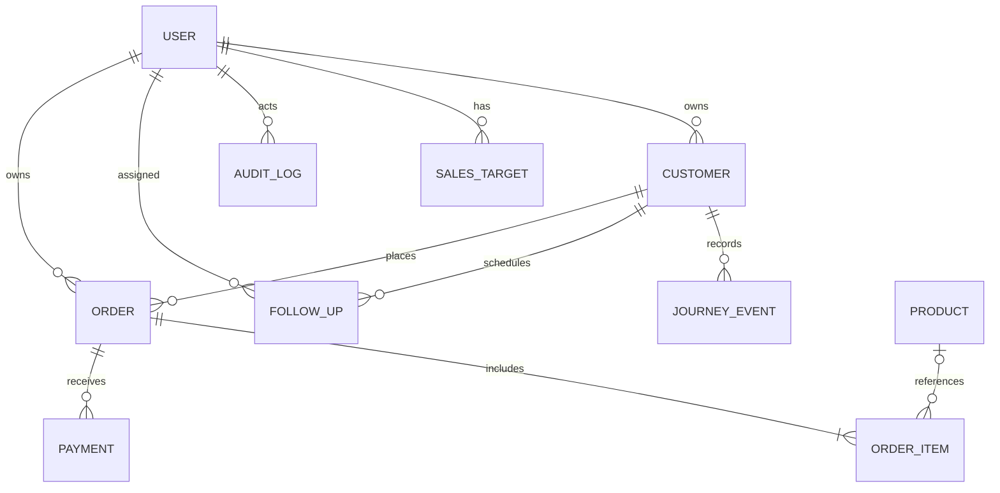

# Data model

Django's default auth User, permissions, sessions, admin log and content-type tables are included through framework migrations. CRM schema is in `crm/migrations/0001_initial.py`; `schema.sql` is the generated SQLite SQL for that migration only.

The diagram shows intended application cardinalities; the order/item minimum is enforced by the formset. Every model has an auto BigAutoField primary key.

| Model | Important fields and relationships | Integrity |
| --- | --- | --- |
| Customer | name, company, email, phone, address, source, stage, owner, estimated_value, notes, timestamps | Owner PROTECT; estimate ≥ 0; stage indexed |
| JourneyEvent | customer, from_stage, to_stage, note, actor, created_at | Customer CASCADE; actor SET_NULL; append-only through application |
| Product | name, unique SKU, price, active | Unique SKU; price ≥ 0 |
| Order | customer, owner, status, order_date, due_date, discount, tax_percent, notes, timestamps | Customer/owner PROTECT; discount ≥ 0; tax 0–100; status/order date indexed |
| OrderItem | order, nullable product, description, quantity, unit_price | Order CASCADE; product PROTECT; quantity ≥ 1; unit price ≥ 0 |
| Payment | order, amount, paid_on, method, reference | Order PROTECT; amount > 0 |
| FollowUp | customer, owner, subject, kind, due_at, priority, status, notes, completed_at | Customer CASCADE; owner PROTECT; due/status indexed |
| SalesTarget | user, month, amount | User PROTECT; unique(user, month); amount > 0 |
| AuditLog | nullable actor, action, entity, object_id, label, created_at | Actor SET_NULL; generic snapshot identity, no FK to business record; timestamp indexed |

Django automatically indexes ForeignKey columns. Ordering uses the fields defined in each model. Money fields use DecimalField(max_digits=12, decimal_places=2); tax uses 5 digits/2 decimals. Totals are derived from order lines, discount and tax; paid/balance are derived from payments. They are not separately stored or susceptible to stale aggregate columns.

## Application-level rules

- A customer and its orders/follow-ups must share the same owner. Reassignment updates related rows in one transaction.
- Order requires at least one item and at most 100; discount ≤ subtotal; due date ≥ order date.
- New payments require booked status and aggregate payments ≤ order total. Order edits cannot reduce the total below payments or cancel/revert an order with payments.
- Targets use first day of month; statuses and stage values are validated by ModelForms.
- Customer/order forms carry an updated_at revision to reject stale submissions. Products, follow-ups, payments and targets do not have revision checks.

These cross-record rules are enforced in the application write views and forms, not SQLite triggers. Direct shell/SQL writes bypass them. Django admin business models are read-only to prevent bypass through that UI. Multi-step writes and their audit entries are atomic. SQLite does not implement row-level SELECT FOR UPDATE locking; concurrent writers may receive database-locked errors. Use backups and move to PostgreSQL with concurrency tests for heavier usage.
